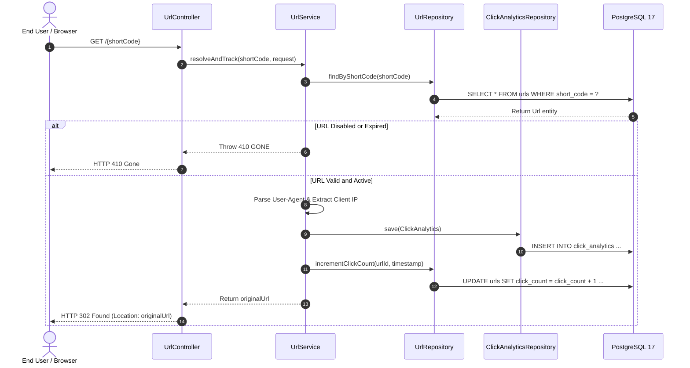
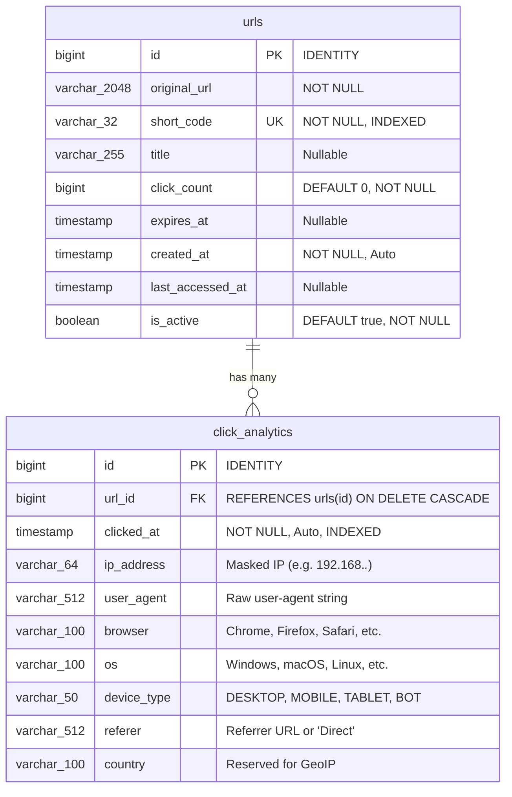
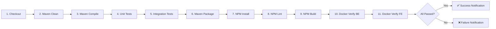

# 🔗 SnapLink — URL Shortener & Real-Time Analytics System

A production-grade, full-stack URL shortening service engineered with **Spring Boot 4 (Java 21)**, **PostgreSQL 17**, and **React 19 (Vite)**. The platform features Base62 short-code generation, custom aliases, link expiration scheduling, real-time client click telemetry (browser, OS, device, IP masking, referrer), multi-stage Docker containerization, and a 13-stage Jenkins CI/CD pipeline.

---

## 📑 Table of Contents
1. [System Overview & Architecture](#-system-overview--architecture)
2. [Key Features](#-key-features)
3. [Repository Structure](#-repository-structure)
4. [Backend Architecture (Spring Boot)](#-backend-architecture-spring-boot)
5. [Frontend Architecture (React 19)](#-frontend-architecture-react-19)
6. [Database Schema & Data Model](#-database-schema--data-model)
7. [REST API Specification](#-rest-api-specification)
8. [DevOps, Docker & Jenkins CI/CD](#-devops-docker--jenkins-cicd)
9. [Configuration & Environment Variables](#-configuration--environment-variables)
10. [Local Development & Deployment Guide](#-local-development--deployment-guide)

---

## 🏛 System Overview & Architecture

SnapLink is designed with a decoupled client-server architecture:
- **Client Tier**: A responsive Single Page Application (SPA) built with React 19 and Vite, styled with custom glassmorphism cyber-dark CSS.
- **API & Core Logic Tier**: A Spring Boot REST application providing link creation, validation, Base62 tokenization, HTTP 302 redirect resolution, and click analytics tracking.
- **Persistence Tier**: PostgreSQL 17 managing transactional URL state and click logs with database indexes and aggregation queries.
- **Edge / Reverse Proxy**: Multi-stage Nginx container routing `/api/` traffic to the backend while serving static React assets with client-side SPA routing fallback.

```mermaid
graph TD
    Client["🌐 Web Browser / End User"]
    Nginx["🛡️ Nginx Reverse Proxy (Port 80)"]
    Frontend["⚛️ React 19 SPA (Static Bundle)"]
    Backend["☕ Spring Boot 4 REST API (Port 8090)"]
    Postgres[("🐘 PostgreSQL 17 Database (Port 5432)")]
    Jenkins["🏗️ Jenkins CI/CD Pipeline"]

    Client -->|HTTP Port 80| Nginx
    Nginx -->|Serves Static Files| Frontend
    Nginx -->|Proxies /api/*| Backend
    Client -->|Direct Redirect /{shortCode} Port 8090| Backend
    Backend -->|Spring Data JPA / HikariCP| Postgres
    Jenkins -.->|Builds, Tests & Packages| Backend
    Jenkins -.->|Lints & Bundles| Frontend
    Jenkins -.->|Validates Images| Backend
```

---

## ✨ Key Features

- **High-Entropy Short Code Generation**: Generates 6-character random Base62 codes (`[0-9a-zA-Z]`) offering ~$56.8\text{ billion}$ unique combinations, with automated collision resolution expanding to 8 characters if required.
- **Custom Vanity Slugs**: Allows users to specify customized aliases (e.g. `/launch-2026`) with conflict validation against existing codes.
- **Link Expiration (TTL)**: Configurable expiration limits (24 hours, 7 days, 30 days) with automatic `410 Gone` responses once expired.
- **Live Link Management**: Toggle links between Active and Disabled states on the fly without deleting data, or permanently remove links via cascading deletion.
- **Real-Time Click Telemetry**:
  - Automatically parses `User-Agent` strings into **Browser** (Chrome, Firefox, Safari, Edge, Opera, API Client, Web Bot), **Operating System** (Windows, macOS, Linux, Android, iOS), and **Device Type** (Desktop, Mobile, Tablet, Bot).
  - Captures `Referer` headers (or flags as "Direct").
  - Extracts client IP address with proxy header inspection (`X-Forwarded-For`), immediately applying privacy masking (`xxx.xxx.*.*`).
- **Real-Time Visual Analytics Dashboard**:
  - Aggregated distributions with percentage progress bars.
  - Audit trail showing the latest 20 clicks with timestamps and masked IPs.
- **Production Hardened**:
  - Non-root user container execution in Alpine JRE.
  - Atomic click counter increments to prevent race conditions.
  - Comprehensive Jenkins automation across 13 stages.

---

## 📂 Repository Structure

```
mini-project/
├── .git/                                   # Git version control metadata
├── Jenkinsfile                             # 13-stage Jenkins Declarative CI/CD pipeline
├── docker-compose.yml                      # Orchestrates Postgres, Backend, and Frontend containers
│
├── backend (urlshort/urlshort)/
│   ├── Dockerfile                          # Multi-stage Eclipse Temurin 21 Dockerfile
│   ├── pom.xml                             # Maven project descriptor & dependencies
│   ├── mvnw / mvnw.cmd                     # Maven wrapper scripts (Unix / Windows)
│   ├── .mvn/wrapper/                       # Maven wrapper binary configurations
│   └── src/
│       ├── main/
│       │   ├── java/com/urlshort/urlshort/
│       │   │   ├── UrlshortApplication.java        # Spring Boot main entrypoint
│       │   │   ├── config/
│       │   │   │   └── WebConfig.java              # Global CORS configuration
│       │   │   ├── controller/
│       │   │   │   └── UrlController.java          # REST API endpoints & redirection handler
│       │   │   ├── dto/
│       │   │   │   ├── ShortenRequest.java         # Request payload for link creation
│       │   │   │   ├── UrlResponse.java            # Standard URL data response
│       │   │   │   └── AnalyticsResponse.java      # Aggregated metrics & recent clicks DTO
│       │   │   ├── entity/
│       │   │   │   ├── Url.java                    # JPA Entity representing shortened URLs
│       │   │   │   └── ClickAnalytics.java         # JPA Entity representing click telemetry
│       │   │   ├── exception/
│       │   │   │   └── GlobalExceptionHandler.java # Centralized REST error interceptor
│       │   │   ├── repository/
│       │   │   │   ├── UrlRepository.java          # Spring Data JPA repo for URLs
│       │   │   │   └── ClickAnalyticsRepository.java # JPA aggregation queries for metrics
│       │   │   ├── service/
│       │   │   │   └── UrlService.java             # Business logic & telemetry processor
│       │   │   └── util/
│       │   │       └── UserAgentParser.java        # UA parsing, Base62 RNG, IP masking
│       │   └── resources/
│       │       └── application.properties          # Spring application configurations
│       └── test/
│           └── java/com/urlshort/urlshort/
│               └── UrlshortApplicationTests.java   # Spring Boot context loading test
│
└── frontend (frontend/urlshortfe)/
    ├── Dockerfile                          # Multi-stage Node 20 builder + Nginx SPA runtime
    ├── package.json                        # Node dependencies (React 19, Vite 8, ESLint)
    ├── package-lock.json                   # Deterministic dependency lockfile
    ├── vite.config.js                      # Vite server config & local backend API proxy
    ├── eslint.config.js                    # ESLint linting configuration
    ├── index.html                          # HTML5 shell
    └── src/
        ├── main.jsx                        # React root entrypoint
        ├── App.jsx                         # Main container component, metrics summary, state
        ├── App.css                         # Application-level dark theme styling
        ├── index.css                       # Global typography and base CSS tokens
        ├── components/
        │   ├── UrlShortenerForm.jsx        # URL creation form with validation & advanced drawer
        │   ├── UrlList.jsx                 # Filterable table of links with quick actions
        │   └── AnalyticsModal.jsx          # Modal overlay with breakdown charts & click audit
        └── services/
            └── api.js                      # Fetch API client abstraction with error mapping
```

---

## ☕ Backend Architecture (Spring Boot)

### 1. Technology Stack
- **Framework**: Spring Boot 4.1.2
- **Language**: Java 21 (Eclipse Temurin)
- **Data Persistence**: Spring Data JPA / Hibernate ORM
- **Database Driver**: `org.postgresql:postgresql` (runtime) + `com.h2database:h2` (test)
- **Validation**: Jakarta Bean Validation (`spring-boot-starter-validation`)
- **Boilerplate Reduction**: Project Lombok

### 2. Core Service Flow & Algorithms



#### Base62 Token Generator
In [`UserAgentParser.java`](file:///c:/Users/Acer/Documents/mini-project/urlshort/urlshort/src/main/java/com/urlshort/urlshort/util/UserAgentParser.java):
```java
private static final String BASE62 = "0123456789abcdefghijklmnopqrstuvwxyzABCDEFGHIJKLMNOPQRSTUVWXYZ";
private static final SecureRandom RANDOM = new SecureRandom();

public static String generateRandomCode(int length) {
    StringBuilder sb = new StringBuilder(length);
    for (int i = 0; i < length; i++) {
        sb.append(BASE62.charAt(RANDOM.nextInt(BASE62.length())));
    }
    return sb.toString();
}
```
If a generated 6-character code collides after 10 retries, [`UrlService.java`](file:///c:/Users/Acer/Documents/mini-project/urlshort/urlshort/src/main/java/com/urlshort/urlshort/service/UrlService.java) automatically generates an 8-character token, providing $62^8 \approx 218\text{ trillion}$ combinations.

#### Atomic Click Incrementation
To avoid lost updates under concurrent access, [`UrlRepository.java`](file:///c:/Users/Acer/Documents/mini-project/urlshort/urlshort/src/main/java/com/urlshort/urlshort/repository/UrlRepository.java) uses an atomic SQL update:
```java
@Modifying
@Query("UPDATE Url u SET u.clickCount = u.clickCount + 1, u.lastAccessedAt = :now WHERE u.id = :id")
void incrementClickCount(@Param("id") Long id, @Param("now") LocalDateTime now);
```

#### Centralized Error Handling
[`GlobalExceptionHandler.java`](file:///c:/Users/Acer/Documents/mini-project/urlshort/urlshort/src/main/java/com/urlshort/urlshort/exception/GlobalExceptionHandler.java) intercepts:
- `ResponseStatusException`: Maps Spring Web status codes (e.g., 404 NOT FOUND, 409 CONFLICT, 410 GONE).
- `MethodArgumentNotValidException`: Extracts individual field validation errors into a clean structured JSON object `{ "errors": { "field": "reason" } }`.
- Generic `Exception`: Standardizes 500 INTERNAL SERVER ERROR with timestamps.

---

## ⚛️ Frontend Architecture (React 19)

### 1. Technology Stack
- **Framework**: React 19 (`react`, `react-dom`)
- **Tooling / Bundler**: Vite 8 with `@vitejs/plugin-react`
- **Linting**: ESLint 10 with `react-hooks` and `react-refresh` plugins
- **Styling**: Vanilla CSS3 with custom variables, animations, and flex/grid responsive systems

### 2. Component Hierarchy
```
App.jsx (Root State, Statistics Banner, Toast Notifications)
 ├── UrlShortenerForm.jsx (Input, Alias/TTL Collapsible Drawer, Validation)
 ├── UrlList.jsx (Real-time Filter Search, Tabular View, Action Triggers)
 └── AnalyticsModal.jsx (Overlay, Breakdown Progress Bars, Click Audit Log)
```

### 3. API Communication Layer
[`src/services/api.js`](file:///c:/Users/Acer/Documents/mini-project/frontend/urlshortfe/src/services/api.js) encapsulates network requests with built-in resilience:
- Parses JSON or fallback plain-text server responses.
- Catches network connectivity issues and formats user-friendly error banners (e.g., notifying when the backend on port 8090 is unreachable).
- Handles proxy integration seamlessly via `import.meta.env.VITE_API_URL || ''`.

---

## 🗄 Database Schema & Data Model



### Aggregation Queries
[`ClickAnalyticsRepository.java`](file:///c:/Users/Acer/Documents/mini-project/urlshort/urlshort/src/main/java/com/urlshort/urlshort/repository/ClickAnalyticsRepository.java) executes native-like JPQL grouping queries for real-time aggregation:
```sql
SELECT c.browser AS name, COUNT(c) AS count 
FROM ClickAnalytics c 
WHERE c.url.id = :urlId 
GROUP BY c.browser 
ORDER BY COUNT(c) DESC;
```
Similar queries compute statistics for OS, Device Type, and Referrer.

---

## 🔌 REST API Specification

### 1. Create Short URL
- **Method & Route**: `POST /api/urls`
- **Request Body**:
```json
{
  "originalUrl": "https://github.com/spring-projects/spring-boot",
  "customAlias": "spring-repo",
  "title": "Spring Boot GitHub",
  "expiresAt": "2026-12-31T23:59:59"
}
```
- **Response**: `201 Created`
```json
{
  "id": 1,
  "originalUrl": "https://github.com/spring-projects/spring-boot",
  "shortCode": "spring-repo",
  "shortUrl": "http://localhost:8090/spring-repo",
  "title": "Spring Boot GitHub",
  "clickCount": 0,
  "expiresAt": "2026-12-31T23:59:59",
  "createdAt": "2026-10-29T18:00:00",
  "lastAccessedAt": null,
  "isActive": true,
  "isExpired": false
}
```

### 2. List All URLs
- **Method & Route**: `GET /api/urls`
- **Response**: `200 OK` (Array of `UrlResponse` objects ordered by creation date descending)

### 3. Get Single URL Details
- **Method & Route**: `GET /api/urls/{shortCode}`
- **Response**: `200 OK` or `404 Not Found`

### 4. Fetch Analytics
- **Method & Route**: `GET /api/urls/{shortCode}/analytics`
- **Response**: `200 OK`
```json
{
  "urlId": 1,
  "shortCode": "spring-repo",
  "originalUrl": "https://github.com/spring-projects/spring-boot",
  "title": "Spring Boot GitHub",
  "totalClicks": 42,
  "createdAt": "2026-10-29T18:00:00",
  "lastAccessedAt": "2026-10-29T18:15:20",
  "browserStats": [
    { "name": "Google Chrome", "count": 28 },
    { "name": "Mozilla Firefox", "count": 14 }
  ],
  "osStats": [
    { "name": "Windows", "count": 30 },
    { "name": "macOS", "count": 12 }
  ],
  "deviceStats": [
    { "name": "Desktop", "count": 40 },
    { "name": "Mobile", "count": 2 }
  ],
  "refererStats": [
    { "name": "Direct", "count": 35 },
    { "name": "https://t.co", "count": 7 }
  ],
  "recentClicks": [
    {
      "id": 105,
      "clickedAt": "2026-10-29T18:15:20",
      "browser": "Google Chrome",
      "os": "Windows",
      "deviceType": "Desktop",
      "referer": "Direct",
      "ipAddress": "192.168.*.*"
    }
  ]
}
```

### 5. Toggle URL Status (Active / Disabled)
- **Method & Route**: `PATCH /api/urls/{id}/toggle`
- **Response**: `200 OK` with updated status.

### 6. Delete URL
- **Method & Route**: `DELETE /api/urls/{id}`
- **Response**: `200 OK` `{ "message": "URL successfully deleted", "id": "1" }`

### 7. Redirect Short Link
- **Method & Route**: `GET /{shortCode}`
- **Behavior**:
  - Validates `isActive` (returns `410 GONE` if disabled).
  - Validates `expiresAt` (returns `410 GONE` if past timestamp).
  - Registers click telemetry asynchronously in `click_analytics`.
  - Atomically increments `clickCount` and updates `lastAccessedAt`.
  - Sends HTTP `302 Found` with `Location: {originalUrl}`.

---

## 🚢 DevOps, Docker & Jenkins CI/CD

### 1. Multi-Stage Docker Builds

#### Backend Dockerfile ([`urlshort/urlshort/Dockerfile`](file:///c:/Users/Acer/Documents/mini-project/urlshort/urlshort/Dockerfile))
- **Stage 1 (Builder)**: `eclipse-temurin:21-jdk-alpine`. Resolves offline dependencies via `./mvnw dependency:go-offline -B` before copying source code to maximize Docker layer cache efficiency. Builds executable JAR with `./mvnw clean package -DskipTests`.
- **Stage 2 (Runtime)**: `eclipse-temurin:21-jre-alpine`. Drops root privileges and runs as an unprivileged user `appuser:appgroup` for container security.
- **Exposed Port**: `8080` (or mapped to `8090` in compose).

#### Frontend Dockerfile ([`frontend/urlshortfe/Dockerfile`](file:///c:/Users/Acer/Documents/mini-project/frontend/urlshortfe/Dockerfile))
- **Stage 1 (Builder)**: `node:20-alpine`. Executes `npm ci` followed by `npm run build` to generate compiled static assets in `/app/dist`.
- **Stage 2 (Runtime)**: `nginx:alpine`. Configured with a built-in reverse proxy rule:
  - Proxies `/api/` requests to `http://backend:8090/api/` with forwarding headers.
  - Resolves SPA client-side routes via `try_files $uri $uri/ /index.html`.
- **Exposed Port**: `80`.

### 2. Docker Compose Orchestration ([`docker-compose.yml`](file:///c:/Users/Acer/Documents/mini-project/docker-compose.yml))
Coordinates all three system components with strict healthcheck dependency ordering:
1. `postgres`: Runs `postgres:17-alpine`, mounts persistent volume `postgres_data`, and runs healthcheck `pg_isready -U postgres -d urlshort`.
2. `backend`: Waits for `postgres` to report healthy before starting.
3. `frontend`: Waits for `backend` to start, exposing port `80`.

### 3. Jenkins CI/CD Pipeline ([`Jenkinsfile`](file:///c:/Users/Acer/Documents/mini-project/Jenkinsfile))



The declarative pipeline executes 13 distinct stages across the full Maven and NPM lifecycles:
1. **Checkout**: Pulls latest repository branch from SCM.
2. **Backend - Clean**: `mvn clean`
3. **Backend - Validate**: Validates project POM structure.
4. **Backend - Initialize**: Sets up build properties.
5. **Backend - Compile**: Compiles Java source files.
6. **Backend - Test Compile**: Compiles test code.
7. **Backend - Unit Tests**: Runs Surefire unit tests (`mvn test`).
8. **Backend - Integration Tests**: Runs integration test verification (`mvn integration-test`).
9. **Backend - Install**: Installs package to local repository.
10. **Backend - Verify**: Verifies package integrity.
11. **Backend - Package**: Bundles production JAR (`mvn package -DskipTests`).
12. **Frontend CI**: Executes `npm ci`, `npm run lint`, and `npm run build`.
13. **Docker Verification**: Verifies availability of production Docker container images from Docker Hub (`guywhobuildsandtests/urlshortbe:latest` and `urlshortfe:latest`).

---

## ⚙️ Configuration & Environment Variables

| Variable | Scope | Default Value | Description |
| :--- | :--- | :--- | :--- |
| `SERVER_PORT` | Backend | `8090` | Port on which the Spring Boot application listens |
| `SPRING_DATASOURCE_URL` | Backend | `jdbc:postgresql://localhost:5432/urlshort` | JDBC connection string |
| `SPRING_DATASOURCE_USERNAME`| Backend | `postgres` | Database username |
| `SPRING_DATASOURCE_PASSWORD`| Backend | `$$DatA_BasE26` | Database password |
| `SPRING_JPA_HIBERNATE_DDL_AUTO` | Backend | `update` | Hibernate schema update behavior |
| `APP_BASE_URL` | Backend | `http://localhost:8090` | Domain used when generating full short URLs |
| `POSTGRES_DB` | Postgres | `urlshort` | Database name initialized in PostgreSQL |
| `POSTGRES_USER` | Postgres | `postgres` | Superuser username for PostgreSQL |
| `POSTGRES_PASSWORD` | Postgres | `$$DatA_BasE26` | Superuser password for PostgreSQL |
| `VITE_API_URL` | Frontend | `""` (empty for proxy) | Base URL for API requests |

---

## 🚀 Local Development & Deployment Guide

### Prerequisites
- **Java**: JDK 21+ installed and on system `PATH`
- **Node.js**: v20+ with `npm`
- **PostgreSQL**: Local instance running on port 5432 or Docker
- **Docker & Docker Compose**: (Optional, for containerized run)

---

### Option A: Running with Docker Compose (Recommended)

1. **Clone the repository**:
   ```bash
   git clone <repo-url>
   cd mini-project
   ```

2. **Launch all services**:
   ```bash
   docker compose up -d
   ```

3. **Verify running containers**:
   ```bash
   docker compose ps
   ```

4. **Access the application**:
   - **Frontend UI**: [http://localhost](http://localhost) (Port 80)
   - **Backend API**: [http://localhost:8090](http://localhost:8090)
   - **Short Link Redirects**: `http://localhost:8090/{shortCode}`

---

### Option B: Running Locally for Development

#### 1. Start PostgreSQL
Ensure PostgreSQL is active on port `5432` with a database named `urlshort`:
```bash
# Using Docker to run PostgreSQL alone:
docker run -d --name urlshort-postgres \
  -e POSTGRES_DB=urlshort \
  -e POSTGRES_USER=postgres \
  -e POSTGRES_PASSWORD=$$DatA_BasE26 \
  -p 5432:5432 \
  postgres:17-alpine
```

#### 2. Run Backend (Spring Boot)
```bash
cd urlshort/urlshort

# On Windows:
.\mvnw.cmd spring-boot:run

# On Linux / macOS:
./mvnw spring-boot:run
```
The backend starts at `http://localhost:8090`.

#### 3. Run Frontend (React + Vite)
```bash
cd frontend/urlshortfe
npm install
npm run dev
```
The frontend dev server starts at `http://localhost:5173`. Any requests to `/api/*` are automatically forwarded to `http://localhost:8090` by Vite's development proxy.

---

## 🔒 Security & Privacy Considerations

- **IP Masking**: Client IP addresses are anonymized before storage (`192.168.1.5` $\rightarrow$ `192.168.*.*`) to respect visitor privacy.
- **Input Sanitization**: URLs are checked for valid prefixes (`http://` or `https://`) and trimmed; custom aliases are constrained to `^[a-zA-Z0-9_-]{3,20}$` to protect against injection attacks and URL spoofing.
- **Non-Root Container**: The backend container executes under a dedicated `appuser` (UID unprivileged) within Alpine Linux.
- **Reserved Slugs Guard**: Redirect routes automatically block internal reserved endpoints (`/api`, `/error`, `/favicon.ico`) to prevent routing collision.
